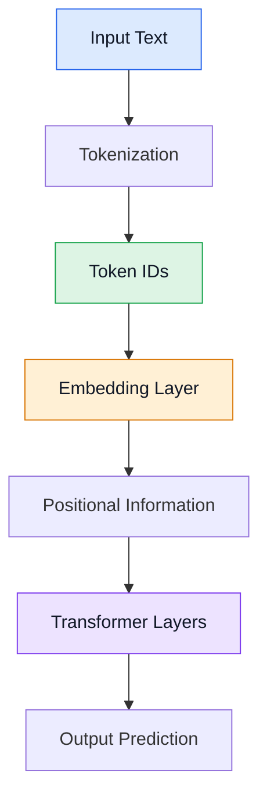

# Embeddings in AI Transformer Architecture

## 1. What Is an Embedding?

An embedding converts discrete items, such as token IDs, into dense numerical vectors that a neural network can process.

Example:

Input text:

```text
AI is powerful
```

Token IDs:

```text
[125, 42, 987]
```

Embedding vectors (illustrative):

```text
125 -> [0.21, 0.45, -0.12, 0.78]
42  -> [0.31, -0.15, 0.62, 0.11]
987 -> [0.85, 0.52, -0.24, 0.67]
```

Each token is represented by a vector containing numerical values.

These values are usually learned during model training.

---

## 2. Where Does Embedding Fit in a Transformer?



### Processing steps

1. Input text is supplied to the model.
2. Tokenization splits the text into tokens.
3. The tokenizer maps tokens to integer IDs.
4. The embedding layer retrieves a vector for each ID.
5. Positional information represents token order.
6. Transformer layers process the vectors using attention and feed-forward networks.

---

## 3. How Does an Embedding Matrix Work?

An embedding layer stores vectors in a learnable matrix.

Suppose:

- Vocabulary size = 4
- Embedding dimension = 3

The embedding matrix has shape:

```text
E = [
    [0.2, 0.4, 0.1],  # Token 0
    [0.3, 0.1, 0.6],  # Token 1
    [0.8, 0.5, 0.2],  # Token 2
    [0.4, 0.9, 0.3]   # Token 3
]
```

Mathematical representation:

E ∈ R^(4 × 3)

This means four tokens are represented by three-dimensional vectors.

### Embedding lookup

Input token IDs:

```text
[0, 1, 2]
```

The embedding layer retrieves rows 0, 1, and 2.

Output:

```text
[
    [0.2, 0.4, 0.1],
    [0.3, 0.1, 0.6],
    [0.8, 0.5, 0.2]
]
```

Output shape:

```text
(3, 3)
```

This represents three tokens, each with three embedding dimensions.

The operation is a row lookup, not a new calculation of each vector from scratch.

---

## 4. Types of Embeddings

### 4.1 Word Embeddings

Represent words as numerical vectors.

Examples:
- Word2Vec
- GloVe

Words with similar learned usage may have vectors that are close in the embedding space.

### 4.2 Subword Embeddings

Represent word pieces as vectors.

Example:

```text
unhappiness
    |
    v
["un", "happi", "ness"]
    |
    v
Embedding lookup for each token
```

Subword embeddings are commonly used in modern language models.

### 4.3 Character Embeddings

Represent individual characters as vectors.

Example:

```text
cat
 |
 v
c -> vector
a -> vector
t -> vector
```

Useful in character-based language models and spelling-related tasks.

### 4.4 Positional Embeddings

Represent the positions of tokens in a sequence.

For example:

```text
Position 0 -> positional vector P0
Position 1 -> positional vector P1
Position 2 -> positional vector P2
```

A common approach adds the token embedding to its positional vector.

### 4.5 Sentence Embeddings

Represent an entire sentence as one vector.

Example:

```text
"The weather is nice."
           |
           v
[0.12, 0.45, -0.31, 0.76, ...]
```

Used for semantic search, clustering, and sentence similarity.

### 4.6 Document Embeddings

Represent a larger document as a vector.

Applications:
- Document retrieval
- Similarity search
- Document clustering
- Information retrieval

### 4.7 Image and Multimodal Embeddings

Represent images, audio, or other data as vectors.

Multimodal models can learn compatible representations for different data types, such as images and text.

---

## 5. Static vs. Contextual Embeddings

### Static embeddings

A word generally receives the same vector wherever it appears.

Examples:
- Word2Vec
- GloVe

### Contextual representations

A token's representation changes according to the surrounding text.

Example:

```text
Sentence 1:
The river bank is muddy.

Sentence 2:
I deposited money in the bank.
```

A contextual model can represent the two occurrences of "bank" differently.

Important distinction:

The initial Transformer token embedding is generally a lookup vector. Contextual representations develop as the token passes through Transformer layers.

---

## 6. Main Pseudocode for Embedding

```python
# STEP 1: Create vocabulary
vocabulary = {
    "AI": 0,
    "is": 1,
    "powerful": 2,
    "learning": 3
}

# STEP 2: Set dimensions
vocab_size = 4
embedding_dim = 3

# STEP 3: Initialize embedding matrix
E = [
    [0.2, 0.4, 0.1],
    [0.3, 0.1, 0.6],
    [0.8, 0.5, 0.2],
    [0.4, 0.9, 0.3]
]

# STEP 4: Input text
tokens = ["AI", "is", "powerful"]

# STEP 5: Convert tokens into IDs
token_ids = [
    vocabulary[token]
    for token in tokens
]

# STEP 6: Embedding lookup
embedded_vectors = []

for token_id in token_ids:
    embedded_vectors.append(E[token_id])

# STEP 7: Display result
print("Token IDs:", token_ids)
print("Embeddings:", embedded_vectors)
```

Expected output:

```text
Token IDs: [0, 1, 2]

Embeddings:
[
    [0.2, 0.4, 0.1],
    [0.3, 0.1, 0.6],
    [0.8, 0.5, 0.2]
]
```

The example uses fixed values for clarity. Actual embedding matrices are usually initialized and learned during training.

---

## 7. How Are Embeddings Learned?

Embeddings are commonly learned through optimization during model training.

Training process:

1. Initialize the embedding matrix.
2. Tokenize the training text.
3. Convert tokens to IDs.
4. Retrieve their embedding vectors.
5. Process the vectors through the Transformer.
6. Calculate the prediction loss.
7. Use backpropagation to calculate gradients.
8. Update the embedding matrix and other model parameters.
9. Repeat over many training batches.

### Training pseudocode

```python
initialize_embedding_matrix()
initialize_transformer_parameters()

for batch in training_data:

    token_ids = tokenize(batch.input_text)

    # Retrieve embedding vectors
    X = embedding_matrix[token_ids]

    # Incorporate positional information
    X = add_position_information(X)

    # Process through Transformer
    hidden_states = transformer(X)

    # Predict target tokens
    predictions = output_layer(hidden_states)

    # Calculate prediction error
    loss = calculate_loss(
        predictions,
        batch.target_tokens
    )

    # Calculate gradients
    gradients = backpropagate(loss)

    # Update model parameters
    optimizer.update(gradients)
```

This is conceptual pseudocode. Real implementations also manage batching, attention masks, padding, and other training details.

---

## 8. Positional Information

A Transformer needs information about token order.

In an architecture that uses additive positional embeddings:

$$X_i = E_i + P_i$$

Where:

- $E_i$ = Token embedding.
- $P_i$ = Positional vector.
- $X_i$ = Input representation.

Example:

```python
token_embedding = [0.2, 0.4, 0.1]
position_embedding = [0.1, 0.0, 0.3]

transformer_input = [
    token_embedding[i] + position_embedding[i]
    for i in range(3)
]

print(transformer_input)

# [0.3, 0.4, 0.4]
```

Other Transformer models use alternatives such as rotary positional embeddings (RoPE).

---

## 9. Python Implementation Using PyTorch

```python
import torch
import torch.nn as nn

# Vocabulary size
vocab_size = 10000

# Number of values in each embedding
embedding_dim = 128

# Create a learnable embedding layer
embedding = nn.Embedding(
    num_embeddings=vocab_size,
    embedding_dim=embedding_dim
)

# Example token IDs
token_ids = torch.tensor([15, 82, 104])

# Retrieve embedding vectors
output = embedding(token_ids)

print("Output shape:", output.shape)

# torch.Size([3, 128])
```

### Explanation

- `vocab_size`: Number of possible token IDs.
- `embedding_dim`: Number of numerical values in each vector.
- `nn.Embedding`: Creates a learnable embedding lookup table.
- `token_ids`: Contains the IDs to look up.
- `output`: Contains one vector per input token.

Number of learnable embedding parameters:

10,000 × 128 = 1,280,000

---

## 10. Tokenization vs. Embedding

| Tokenization | Embedding |
|---|---|
| Splits text into tokens | Maps token IDs to vectors |
| Uses tokenizer rules | Uses an embedding matrix |
| Produces discrete token IDs | Produces continuous numerical values |
| Usually occurs before the neural network | Usually learned as part of the neural network |

---

## Conclusion

Embedding converts token IDs into numerical vectors that a Transformer can process.

The embedding layer provides initial token representations. Positional information represents sequence order, and attention layers use surrounding context to develop richer representations.

Embeddings are essential to modern language models, semantic search, recommendation systems, image understanding, and multimodal AI.

**Previous Topic:** [Tokenizer](../tokenization/tokenization.md)

**Next Topic:** [Positional encoding](../Positional-encoding/Positional-encoding.md)