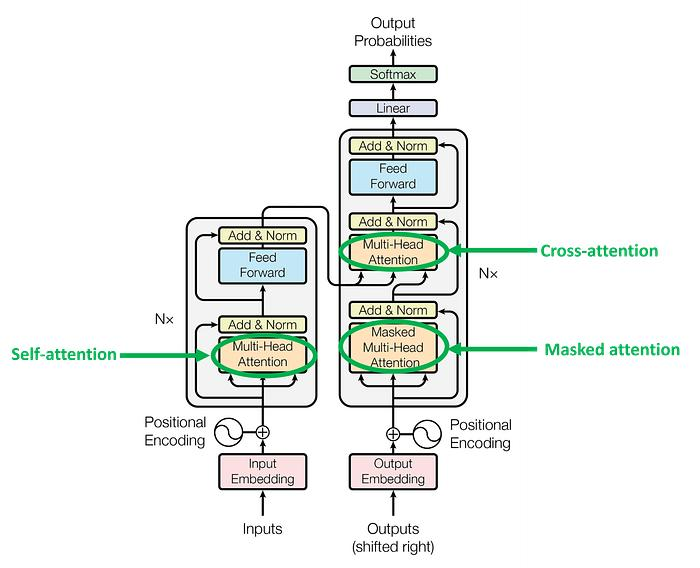

# Encoder and Decoder Architecture in Transformers

## 1. Introduction

The Transformer is a deep learning architecture introduced in the paper *Attention Is All You Need* in 2017.

The original Transformer architecture consists of two major parts:

1. **Encoder** – Processes the input and creates contextual representations.
2. **Decoder** – Uses the Encoder's representations and previously generated tokens to produce an output sequence.

For example, in machine translation:

**Input:** I love learning.

**Output:** J'aime apprendre.

The Encoder processes the input sentence, and the Decoder generates the translated sentence.

Modern Transformer models can use both parts, only an Encoder, or only a Decoder.

---

## 2. Complete Transformer Architecture



The original Encoder-Decoder Transformer can be represented as follows:

```text
                 INPUT SENTENCE
                       |
                Tokenization
                       |
                Input Embeddings
                       |
                Positional Encoding
                       |
              +-------------------+
              |                   |
              |     ENCODER       |
              |                   |
              |  Multi-Head       |
              |  Self-Attention   |
              |        |          |
              |  Residual +        |
              |  Normalization    |
              |        |          |
              |  Feed-Forward     |
              |  Network          |
              |        |          |
              |  Residual +        |
              |  Normalization    |
              |                   |
              +-------------------+
                       |
                Encoder Outputs
                       |
                       v
              +-------------------+
              |      DECODER      |
              |                   |
 Target ------|  Masked Self-     |
 Tokens       |  Attention        |
              |        |          |
              |  Cross-Attention <|
              |        |          |
              |  Feed-Forward     |
              |  Network          |
              |                   |
              +-------------------+
                       |
                Output Projection
                       |
                  Softmax
                       |
                Next Token
                       |
                 Final Output
```

This is a simplified representation of the original architecture. Each Encoder and Decoder stack contains multiple layers, and residual connections and normalization surround the relevant sublayers.

---

## 3. What Is an Encoder?

The Encoder processes the input sequence and converts it into contextual representations.

These representations capture information about the input tokens and their relationships with other tokens.

### Main Components of the Encoder

The original Transformer Encoder contains:

1. Input Embeddings
2. Positional Encoding
3. Multi-Head Self-Attention
4. Residual Connections
5. Layer Normalization
6. Feed-Forward Neural Network

### How the Encoder Works

Step 1: Tokenization

The input sentence is divided into tokens.

Example:

`"The cat is sleeping"`

The tokenizer converts the text into token IDs.

Step 2: Input Embeddings

Each token ID is converted into a numerical vector.

These vectors represent learned token features.

Step 3: Positional Encoding

Positional information is added to the token representations so that the model can use information about token order.

The original Transformer uses sinusoidal positional encodings.

Step 4: Multi-Head Self-Attention

Each input token can attend to other input tokens.

For example, when processing "sleeping", the model can use information from "cat" and "The".

Step 5: Residual Connections and Layer Normalization

Residual connections provide shortcut paths, while layer normalization helps stabilize the representations.

Step 6: Feed-Forward Network

The feed-forward network transforms each token representation independently using learned linear layers and a nonlinear activation.

Step 7: Encoder Output

The Encoder produces a contextual representation for each input position.

These representations are passed to the Decoder through cross-attention in the original architecture.

### Encoder Flow

```text
Input Sentence
      |
Tokenization
      |
Input Embeddings
      |
Positional Encoding
      |
Multi-Head Self-Attention
      |
Residual Connection
      |
Layer Normalization
      |
Feed-Forward Network
      |
Residual Connection
      |
Layer Normalization
      |
Encoder Output
```

The original Transformer stacks multiple Encoder layers.

---

## 4. What Is a Decoder?

The Decoder generates an output sequence using previously generated tokens and, in an Encoder-Decoder Transformer, information from the Encoder.

For example:

**Input:** "How are you?"

**Possible output:** "Comment allez-vous ?"

The Decoder generates the translated sentence one token at a time during autoregressive inference.

### Main Components of the Original Transformer Decoder

The original Decoder layer contains:

1. Target Token Embeddings
2. Positional Encoding
3. Masked Multi-Head Self-Attention
4. Cross-Attention
5. Feed-Forward Neural Network
6. Residual Connections
7. Layer Normalization

The Decoder stack is followed by an output projection that produces vocabulary logits.

### How the Decoder Works

Step 1: Target Token Embeddings

The Decoder receives the target tokens generated so far.

During training, it receives the target sequence shifted right, beginning with a start token.

Step 2: Positional Encoding

Positional information is incorporated into the target token representations.

Step 3: Masked Self-Attention

The Decoder uses causal masking so that each position cannot attend to future target tokens.

This prevents the model from using future answers when predicting the next token.

Step 4: Cross-Attention

In the original Encoder-Decoder Transformer, the Decoder accesses the Encoder output through cross-attention.

- Queries come from the Decoder.
- Keys come from the Encoder output.
- Values come from the Encoder output.

This allows the Decoder to use information from the input sequence while generating its output.

Step 5: Feed-Forward Network

The Decoder transforms its token representations using a feed-forward neural network.

Step 6: Output Projection

The final Decoder representations are mapped to vocabulary logits.

Softmax can convert these logits into probabilities for possible next tokens.

Step 7: Next-Token Generation

A decoding strategy selects or samples the next token. The process continues until an end token or another stopping condition is reached.

### Decoder Flow

```text
Previously Generated Tokens
             |
      Target Embeddings
             |
      Positional Encoding
             |
      Masked Self-Attention
             |
      Cross-Attention <---- Encoder Output
             |
      Feed-Forward Network
             |
      Output Projection
             |
           Softmax
             |
       Next Token
```

The original Decoder layer includes residual connections and layer normalization around its sublayers.

---

## 5. Self-Attention vs. Cross-Attention

Attention is one of the most important concepts in Transformers.

### Self-Attention

Queries, keys, and values come from the same sequence:

$$
\text{Attention}(Q, K, V) = \text{softmax}\left(\frac{QK^T}{\sqrt{d_k}}\right)V
$$

In the Encoder, input tokens attend to other input tokens.

In the original Decoder, target tokens use masked self-attention to attend only to permitted positions, including the current position.

### Cross-Attention

Queries come from one sequence, while keys and values come from another sequence:

$$
\text{CrossAttention}(Q_{\text{decoder}}, K_{\text{encoder}}, V_{\text{encoder}}) = \text{softmax}\left(\frac{Q_{\text{decoder}} K_{\text{encoder}}^T}{\sqrt{d_k}}\right)V_{\text{encoder}}
$$

In the original Transformer:

- Queries ($Q$) come from the Decoder.
- Keys ($K$) and values ($V$) come from the Encoder.

This allows the Decoder to access relevant information from the input.

### Comparison

| Feature | Self-Attention | Cross-Attention |
|---|---|---|
| Query source | Same sequence as keys and values | Different sequence from keys and values |
| Key source | Same sequence | Another sequence |
| Value source | Same sequence | Another sequence |
| Encoder usage | Yes | Not in the original Encoder |
| Original Decoder usage | Yes, with causal masking | Yes |
| Main purpose | Model relationships within a sequence | Connect Decoder processing to Encoder representations |

---

## 6. Why Does the Decoder Need Masked Self-Attention?

During text generation, the model should predict the next token without seeing the actual future tokens.

Consider:

`I am learning AI`

When predicting "learning", a causal Decoder can use:

`I am`

It must not use the future token "AI" to predict "learning".

A causal attention mask prevents attention to future positions.

This is important for autoregressive training and generation.

**Note:** Encoder self-attention in the original Transformer is not causally masked. It can attend to all input positions, subject to padding masks.

---

## 7. Why Does the Decoder Need Cross-Attention?

Suppose the task is to translate:

**English input:** "The weather is beautiful."

**French output:** "Le temps est magnifique."

The Encoder processes the English input into contextual representations.

While generating French tokens, the Decoder uses cross-attention to access those Encoder representations.

This allows the generated output to be conditioned on the original input.

Without cross-attention, the original Decoder would not have this direct attention mechanism for accessing the Encoder's output.

Decoder-only language models work differently: they condition on their input and generated context through causal self-attention rather than using an Encoder stack and cross-attention.

---

## 8. Where Do the Transformer Components Fit?

The components learned in the previous topics appear in different parts of the architecture.

| Component | Encoder | Original Decoder |
|---|---|---|
| Input or token embeddings | Yes | Yes, for target tokens |
| Positional encoding | Yes | Yes |
| Self-attention | Yes | Yes, with causal masking |
| Multi-head attention | Yes | Yes |
| Cross-attention | No | Yes |
| Residual connections | Yes | Yes |
| Layer normalization | Yes | Yes |
| Feed-forward network | Yes | Yes |
| Output projection | Not normally used for final sequence generation | Yes, for vocabulary predictions |

The exact details vary across Transformer architectures. For example, modern models may use rotary positional embeddings instead of adding sinusoidal positional encodings.

---

## 9. Encoder-Only, Decoder-Only, and Encoder-Decoder Models

Not all Transformer models contain both an Encoder and a Decoder.

### A. Encoder-Only Models

Example: BERT

Encoder-only models use bidirectional self-attention, allowing each token to use information from tokens on either side, subject to the attention mask.

Common applications:

- Text classification
- Sentiment analysis
- Named entity recognition
- Extracting information from documents

These models are designed primarily for learning contextual representations rather than standard autoregressive text generation.

### B. Decoder-Only Models

Examples: GPT-style language models

Decoder-only models use causal self-attention to predict tokens based on preceding context.

Common applications:

- Text generation
- Conversational AI
- Code generation
- Autoregressive language modeling

A typical GPT-style model does not contain the Encoder stack or the Encoder-Decoder cross-attention layer.

### C. Encoder-Decoder Models

Examples: The original Transformer and T5

Encoder-Decoder models contain both stacks.

The Encoder processes the input, and the Decoder generates an output conditioned on the Encoder representations.

Common applications:

- Machine translation
- Text summarization
- Sequence-to-sequence transformation
- Input-conditioned text generation

### Comparison Table

| Feature | Encoder-Only | Decoder-Only | Encoder-Decoder |
|---|---|---|---|
| Encoder stack | Yes | No | Yes |
| Decoder stack | No | Yes | Yes |
| Typical attention | Bidirectional self-attention | Causal self-attention | Encoder self-attention and Decoder self-attention |
| Cross-attention | No in the standard Encoder-only design | No in standard GPT-style models | Yes, in the original architecture |
| Common purpose | Input understanding | Autoregressive generation | Input-conditioned generation |

---

## 10. Training an Encoder-Decoder Transformer

During training, the model typically receives the input sequence and a target sequence.

For example:

**Input:** "I love you"

**Target:** "Je t'aime"

The training process works as follows:

1. The Encoder processes the input sentence.
2. The target sequence is shifted right to create Decoder inputs.
3. The Decoder processes the available target tokens using causal masking.
4. Cross-attention allows the Decoder to access Encoder outputs.
5. The output projection produces vocabulary logits.
6. The model calculates a loss against the correct target tokens.
7. Backpropagation updates the model parameters.

Training usually processes multiple target positions in parallel using the causal attention mask, rather than generating every target token sequentially.

During inference, autoregressive generation generally produces one token at a time.

---

## 11. Advantages of the Encoder-Decoder Architecture

- Separates input representation learning from output generation.
- Allows the Decoder to use information from the input through cross-attention.
- Supports many sequence-to-sequence tasks.
- Allows parallel computation across positions during training.
- Can model complex relationships between source and target sequences.

## 12. Limitations

- Contains separate Encoder and Decoder stacks, which can increase model complexity.
- Cross-attention adds additional computation.
- Autoregressive inference generates output tokens sequentially.
- Long sequences can require substantial memory and computation.

These limitations depend on the architecture, sequence length, and implementation.

---

## 13. Real-World Applications

Encoder-Decoder Transformers can be used for:

- Machine translation
- Text summarization
- Question answering
- Speech recognition and transcription
- Converting input sequences into output sequences
- Conditional text generation

Encoder-only and Decoder-only Transformers are also widely used for their respective tasks.

---

## 14. Final Summary

The original Transformer architecture has two major components.

### Encoder

- Processes the input sequence.
- Uses self-attention.
- Applies feed-forward transformations.
- Produces contextual representations.

### Decoder

- Processes previously generated or provided target tokens.
- Uses masked self-attention.
- Uses cross-attention to access Encoder outputs.
- Applies feed-forward transformations.
- Produces vocabulary predictions through an output projection.

### Remember

**Encoder = Processes the input.**

**Decoder = Generates the output.**

**Self-attention = Relates tokens within a sequence.**

**Cross-attention = Lets the Decoder access Encoder representations.**

Understanding these components provides a foundation for understanding how the original Transformer works and how modern architectures such as BERT and GPT differ.

---

## Related Topics

- [Positional Encoding](../Transformer/Positional-encoding/Positional-encoding.md)
- [Self-Attention](../Transformer/Self-Attention/Self-Attention.md)
- [Multi-Head Attention](../Transformer/Multi-Head-Attention/Multi-Head-Attention.md)
- [Residual Connections and Layer Normalization](../Transformer/Residual-Connections-&-Layer-Normalization/Residual-Connections-&-Layer-Normalization.md)
- [Feed-Forward Network](../Transformer/Feed-Forward-Network/Feed-Forward-Network.md)
- [Output Layer](../Transformer/Output-Layer/Output-Layer.md)
- [What We Built: Architecture Analysis](what-we-build.md)
