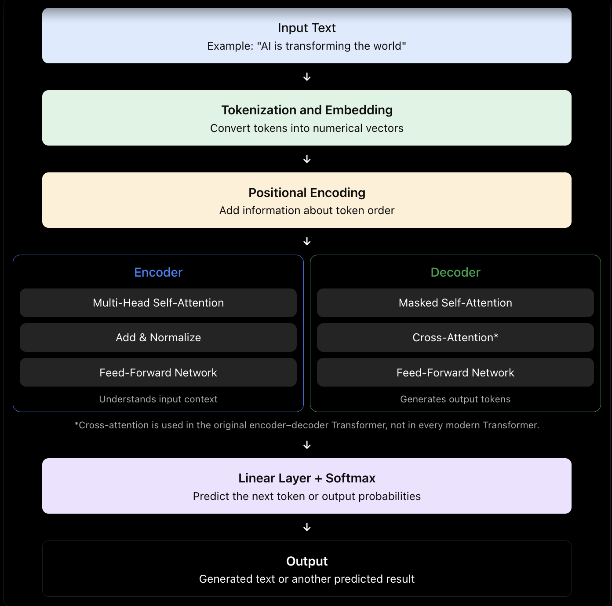
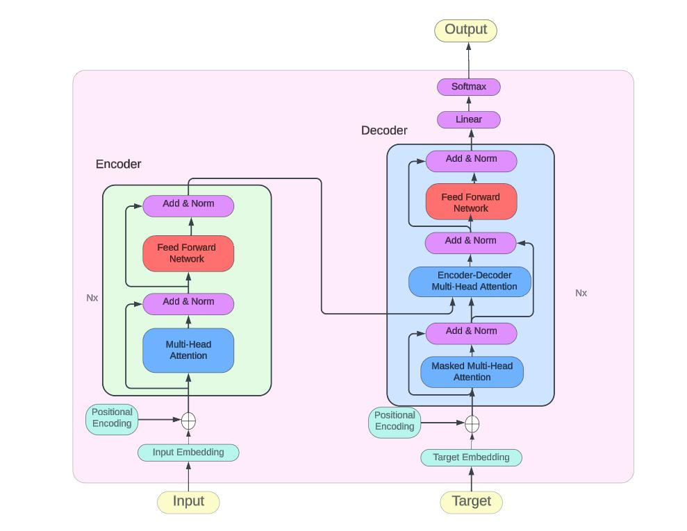

# AI Transformer Architecture

## 1. Transformer Architecture Diagram

## 2. Explanation of Components

### 1. Input Text
The text or data provided to the AI model.

### 2. Tokenization
Divides the input into smaller units called tokens.

Example: `AI is powerful` becomes tokens such as `AI`, `is`, and `powerful`.

### 3. Token Embedding
Converts tokens into numerical vectors that the neural network can process.

### 4. Positional Encoding
Adds information about the position of each token in the sequence.

### 5. Encoder
Processes the input and creates contextual representations.

### 6. Multi-Head Self-Attention
Identifies relationships between different tokens using multiple attention heads.

### 7. Add & Normalize
Uses residual connections and layer normalization to support stable training.

### 8. Feed-Forward Network
Processes each token representation to learn more complex features.

### 9. Decoder
Generates output tokens using previously generated tokens and encoder information.

### 10. Masked Self-Attention
Prevents the decoder from accessing future tokens during generation.

### 11. Encoder-Decoder Attention
Allows the decoder to use relevant information from the encoder output.

### 12. Linear Layer
Converts the final hidden representation into scores for possible output tokens.

### 13. Softmax
Converts token scores into probabilities.

### 14. Output Text
Produces the final generated response, one token at a time.

## 3. Self-Attention Formula

The central equation of Transformer attention is:

$$
\text{Attention}(Q, K, V) = \text{softmax}\left(\frac{QK^T}{\sqrt{d_k}}\right)V
$$

- **$Q$ (Query):** Represents the information a token is looking for.
- **$K$ (Key):** Represents the features used to match tokens.
- **$V$ (Value):** Represents the information passed through attention.
- **$d_k$:** Dimension of the key vectors.

## 4. Simplified Working Flow

Input Text
    ↓
Tokenization
    ↓
Token Embedding
    ↓
Positional Encoding
    ↓
Self-Attention
    ↓
Feed-Forward Network
    ↓
Output Prediction
    ↓
Generated Text

## 5. Types of Transformer Architecture

| Architecture | Main Purpose | Example |
|---|---|---|
| Encoder-only | Understand input | BERT |
| Decoder-only | Generate text | GPT |
| Encoder-decoder | Transform input into output | T5 |

## 6. Applications

- Chatbots and virtual assistants
- Machine translation
- Text summarization
- Image generation and recognition
- Speech recognition
- Code generation
- Large Language Models (LLMs)

## Conclusion

Transformer architecture uses self-attention to learn relationships between tokens. Its major components include embeddings, attention layers, feed-forward networks, and output prediction layers. It is a foundation of many modern AI systems.

**Note:** This diagram represents the original encoder-decoder Transformer. GPT-style models generally use decoder-only architecture.

**Next Topic:** [Tokenizer](../Transformer/tokenization/tokenization.md)

