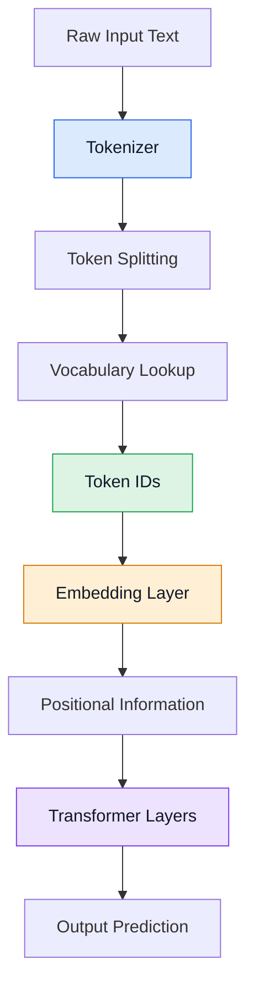

# Tokenization in AI Transformers

## 1. What Is Tokenization?

Tokenization is the process of splitting input text into smaller units called tokens so that an AI model can process the text.

The tokenizer converts text into tokens and maps them to integer IDs using a vocabulary.

### Example

Input text:

```text
AI is powerful!
```

Step 1: Tokenization

```text
["AI", "is", "powerful", "!"]
```

Step 2: Convert tokens into IDs

```text
[125, 42, 987, 15]
```

Step 3: Embedding

Each token ID is mapped to a numerical vector.

Step 4: Positional Information

Information about token positions is incorporated into the model input.

Step 5: Transformer Layers

Self-attention and feed-forward networks process the vectors.

Note: Token IDs are illustrative. Actual IDs depend on the tokenizer and vocabulary.

---

## 2. Types of Tokenization

### 2.1 Word-Level Tokenization

Word-level tokenization splits text into complete words.

Example:

```text
Input:
I love AI

Tokens:
["I", "love", "AI"]
```

Advantages:
- Easy to understand and implement.
- Preserves complete words as tokens.

Disadvantages:
- Requires a large vocabulary.
- May struggle with unknown words.
- Word forms such as "play", "playing", and "played" may require separate entries.

### 2.2 Character-Level Tokenization

Character-level tokenization splits text into individual characters.

Example:

```text
Input:
cat

Tokens:
["c", "a", "t"]
```

Advantages:
- Can represent unfamiliar words using known characters.
- Uses a relatively small vocabulary.

Disadvantages:
- Produces longer sequences.
- Requires the model to learn word-level patterns from individual characters.

### 2.3 Subword-Level Tokenization

Subword tokenization splits words into frequently occurring smaller units.

Example:

```text
Input:
unhappiness

Possible tokens:
["un", "happi", "ness"]
```

The exact segmentation depends on the tokenizer.

Advantages:
- Balances vocabulary size and sequence length.
- Handles many unfamiliar words.
- Reuses common word components.

Disadvantages:
- Requires a trained tokenizer.
- Some words may be split into several tokens.

Modern Transformer language models commonly use subword tokenization.

### 2.4 Byte-Level Tokenization

Byte-level tokenization uses encoded bytes as the basis for representing text.

Example:

```text
Character:
A

ASCII / UTF-8 byte value:
65
```

Advantages:
- Can represent arbitrary text through byte sequences.
- Avoids needing a separate vocabulary entry for every possible character.

Disadvantages:
- Some text requires more tokens than subword-based approaches.
- Byte sequences may be less intuitive to interpret.

---

## 3. Important Subword Tokenization Algorithms

### 3.1 Byte Pair Encoding (BPE)

BPE repeatedly merges frequently occurring adjacent units to create larger tokens.

Simplified example:

```text
Initial units:
l o w e r

Possible merges:
l + o = lo
lo + w = low
e + r = er

Possible final tokens:
["low", "er"]
```

The actual merges depend on the tokenizer's training data and learned rules.

Main idea:

Frequently occurring combinations become larger tokens.

Example use:
- GPT-family tokenizers, including byte-level BPE variants.

### 3.2 WordPiece

WordPiece builds a vocabulary of subword units and selects a segmentation based on learned vocabulary scores.

Example:

```text
Input:
playing

Possible tokens:
["play", "##ing"]
```

In BERT-style tokenization, the prefix `##` indicates that the token continues a word.

Example use:
- BERT.

### 3.3 Unigram Language Model

Unigram tokenization begins with a large candidate vocabulary and removes tokens that contribute least to the tokenization objective.

Example:

```text
Input:
unwanted

Possible tokens:
["un", "want", "ed"]
```

The exact segmentation depends on the vocabulary and learned probabilities.

Example use:
- SentencePiece-based tokenizers, including those using the Unigram algorithm.

---

## 4. Tokenization Methods Comparison

| Method | Basic Principle | Example Use |
|---|---|---|
| Word-level | Splits text into words | Simple NLP systems |
| Character-level | Splits text into characters | Character-based models |
| BPE | Merges frequently occurring units | GPT-family tokenizers |
| WordPiece | Selects subwords using learned scores | BERT |
| Unigram | Selects a likely segmentation | Some SentencePiece models |
| Byte-level | Uses byte-based representations | Some GPT-family tokenizers |

Note: These methods are not mutually exclusive. For example, byte-level BPE combines byte-based input representation with BPE merges.

---

## 5. Main Pseudocode for Tokenization

This example demonstrates word-level tokenization and conversion into token IDs.

```python
# STEP 1: Input text
text = "AI is powerful"

# STEP 2: Tokenization
tokens = text.split()

# Output:
# ["AI", "is", "powerful"]

# STEP 3: Create a vocabulary
vocabulary = {
    "AI": 0,
    "is": 1,
    "powerful": 2
}

# STEP 4: Convert tokens into IDs
token_ids = []

for token in tokens:
    token_id = vocabulary[token]
    token_ids.append(token_id)

# Output:
# [0, 1, 2]

# STEP 5: Pass token IDs to the embedding layer
# embedding_vectors = embedding_layer(token_ids)
```

This is a simplified implementation. Production tokenizers handle punctuation, unknown tokens, subwords, special tokens, and other rules.

---

## 6. Transformer Input Pipeline



### Explanation of the Pipeline

1. **Raw Input Text:** The user provides a sentence or other text.
2. **Tokenizer:** Processes the input according to the tokenizer's rules.
3. **Token Splitting:** Divides the input into words, subwords, characters, or other units.
4. **Vocabulary Lookup:** Maps each token to an integer ID.
5. **Token IDs:** Produces the numerical sequence consumed by the model.
6. **Embedding Layer:** Converts token IDs into numerical vectors.
7. **Positional Information:** Represents token order using the model's positional mechanism.
8. **Transformer Layers:** Process the vectors using attention and feed-forward networks.
9. **Output Prediction:** Produces a prediction or generates output tokens.

---

## 7. Key Differences: Tokenization vs. Embedding

| Tokenization | Embedding |
|---|---|
| Splits text into tokens | Converts token IDs into vectors |
| Uses tokenizer rules and vocabulary | Uses an embedding matrix |
| Produces discrete token IDs | Produces continuous numerical vectors |
| Usually performed before the neural network | Usually learned as part of the neural network |

### Final Summary

Tokenization determines how text is divided into tokens. The vocabulary maps tokens to integer IDs, and the embedding layer converts those IDs into vectors.

Subword methods such as BPE, WordPiece, and Unigram are important in modern Transformer models because they balance vocabulary size with the ability to represent unfamiliar words.
